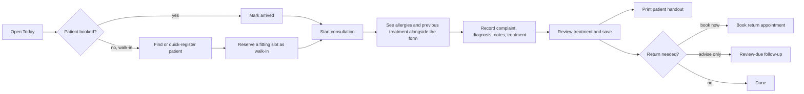

# Hope Clinic - Business Requirements Document (BRD)

| | |
| --- | --- |
| Document | Business Requirements Document |
| Version | 1.0 (retrospective baseline) |
| Date | 4 October 2026 |
| Product | Hope Clinic web app (https://hope-clinic.web.app) |
| Sponsor and maintainer | Munsif Musthafa |
| Business owner and primary user | The Doctor - Unani practitioner running a home-based clinic |
| Status | Draft for the Doctor's review and sign-off |

> **About this document.** The app was built from December 2025 without written requirements. This BRD is written after the fact. It records what the business need actually is, what was built against it, and what is still open. Requirement status reflects the code as of commit `a8bb6c7` and the 16 September 2026 release. Where something has not been confirmed with the Doctor, it is marked as an assumption or open decision rather than presented as fact.

## 1. Executive summary

The Doctor runs a solo, home-based Unani practice. Patient history lives in paper files, return visits are remembered informally, and consultation times are not reserved. Hope Clinic is a private web app that replaces the paper file for day-to-day work: find the patient, see what was prescribed last time, record today's consultation once, hand the patient a printed prescription, and leave with the next appointment settled.

A first version was used for roughly two months (to around February 2026) and then dropped. The suspected cause is data-entry burden, but this was never confirmed with the Doctor. A reliability and workflow redesign was delivered and deployed on 16 September 2026. The single most important business question now is not technical: **will the Doctor use it on most clinic days without the developer's help?** Everything in this document is framed around answering that.

## 2. Background and problem statement

### 2.1 Current way of working (as-is)

- Each patient has a paper file. Previous treatment is found by pulling and reading the file.
- Prescriptions are handwritten.
- Return visits are advised verbally ("come back in two weeks"). Nobody tracks whether the patient came back.
- There is no reservation of time. Patients arrive when they choose, so waiting is unpredictable and sessions overrun.
- If the Doctor dispenses medicines, stock is tracked mentally or on paper.

### 2.2 Problems this causes

| # | Problem | Who feels it | Consequence |
| --- | --- | --- | --- |
| P1 | Previous treatment is slow to find and depends on the paper file being present | Doctor | Time lost per consultation, risk of repeating or contradicting earlier treatment |
| P2 | Allergies and key history are not visible at the point of prescribing | Doctor, patient | Patient safety risk |
| P3 | Return visits are not tracked | Doctor, patient | Patients lapse from treatment without anyone noticing |
| P4 | No appointment capacity | Doctor, patient | Crowding, long waits, unpredictable end of day |
| P5 | Carrying and storing paper files | Doctor | Physical burden, risk of loss or damage, no backup |
| P6 | Handwritten prescriptions | Patient | Legibility, no copy retained |

### 2.3 Why the first version was not sustained (hypotheses, unconfirmed)

1. Too much entry before any value: long registration and a long consultation form.
2. Returning patients still needed retyping; previous treatment was not visible while writing today's.
3. Return dates looked like appointments but did not reserve time.
4. Prescriptions entered in the form were not shown in patient history (fixed since).
5. Inventory problems could block saving a consultation.
6. Unsaved work was lost on reload or interruption.

These must be tested with the Doctor (section 13), not assumed.

## 3. Business objectives

| ID | Objective | Measure | Target (provisional, to agree with the Doctor) |
| --- | --- | --- | --- |
| BO-1 | Faster access to patient history | Time to find a returning patient and state their last treatment | About 20 seconds or less |
| BO-2 | Less administrative effort per consultation | Admin time per encounter, including after-hours catch-up, against a measured paper baseline | 30% reduction |
| BO-3 | Sustained voluntary use | Share of clinic days the app is used; share of in-scope encounters recorded | 80% of clinic days and 80% of encounters by week 6 of the pilot |
| BO-4 | Predictable clinic sessions | Bookings with a confirmed time; double bookings | No silently overlapping bookings; most returns leave with a confirmed time |
| BO-5 | Continuity of care | Advised returns that are either booked, completed, or closed with a reason | No "lost" review advice |
| BO-6 | Records are safe and private | Lost records, wrong-patient saves, private notes appearing on patient printouts, unauthorised access | Zero. Any single occurrence blocks rollout |

No baseline has been measured yet. Measuring one (section 13) is a prerequisite for claiming any of these.

## 4. Stakeholders and users

| Stakeholder | Role | Interest | Involvement |
| --- | --- | --- | --- |
| The Doctor | Business owner, primary user, clinician of record | Less paperwork, safe prescribing, a calmer day | Approves requirements, pilots the app, decides clinical rules |
| Assistant (optional, not confirmed to exist) | Registers patients, books appointments, may dispense | Simple booking and lookup | Uses a restricted role |
| Patients | Indirect beneficiaries | Legible prescription, a definite return time, privacy | Receive printouts; their data is stored |
| Munsif (sponsor) | Builder, maintainer, sole support | A tool that actually helps, low running cost | Builds, deploys, supports |
| Google (Firebase) | Hosting and data processor | - | Stores all clinical data |

### 4.1 Personas

**The Doctor.** Uses a laptop during consultations and a phone to check information away from the desk. Comfort with typing, preferred typing language, and whether dictation is wanted are unknown. Clinical judgement must stay with her; the app must never invent, infer, or silently repeat clinical content.

**The Assistant.** May or may not exist. If present: registers patients, books and reschedules appointments, marks arrivals, possibly dispenses. Must never appear as the treating clinician on a printout.

## 5. Scope

### 5.1 In scope (single-clinic pilot)

- Secure sign-in for approved clinic staff with Doctor and Assistant roles.
- Patient register: identity, contact, demographics, medical and family history, ongoing medicines, allergies.
- Consultation records: complaint, diagnosis, private notes, patient instructions, structured prescriptions, investigations advised, fees.
- Previous-visit context and reviewed reuse of previous treatment.
- Printed patient handout (prescription sheet).
- Follow-up (review due) tracking.
- Daily sessions, appointment booking, walk-ins, arrival, start, completion, cancellation, no-show, reschedule.
- Optional medicine inventory with stock deducted on dispensing.
- Basic dashboard (counts, revenue, low stock).
- Works on laptop and phone; installable as an app; tolerates poor connectivity for reading.

### 5.2 Out of scope for this phase

- Multiple clinics or multiple doctors sharing one installation.
- Patient-facing portal or online self-booking.
- SMS or WhatsApp reminders.
- Billing, invoicing, insurance, accounting.
- Lab result import, document or image attachments.
- AI-generated clinical content or treatment suggestions.
- Back-entry of historical paper records (bring records forward as patients return).
- Native mobile apps.

### 5.3 Future candidates (only after the pilot proves value)

Durable cross-device drafts, separating prescribing from dispensing, reminders, a medicine catalogue independent of stock, clinic settings (name, hours, currency, print header), multi-clinic tenancy, data export.

## 6. Future-state process (to-be)

## 7. Business requirements

Priority uses MoSCoW for the pilot. Status: **Met** (built and verified), **Partial**, **Not met**. Detailed functional requirements are in the [SRS](SRS.md).

| ID | Requirement | Priority | Status | Notes |
| --- | --- | --- | --- | --- |
| BR-01 | Only approved clinic staff can see or change clinical data | Must | Met (single clinic) | Role check in Firestore rules and route guard. Not multi-clinic safe |
| BR-02 | Register a patient quickly and continue straight into care or booking | Must | Met | Name, age and contact still mandatory - needs the Doctor's decision |
| BR-03 | Find the right patient reliably, including same names and shared phone numbers | Must | Met | Search by name, record ID, contact digits. Duplicate warning, no auto-merge |
| BR-04 | Show allergies and previous treatment while recording a consultation | Must | Met | Side panel on laptop, stacked on phone |
| BR-05 | Record a consultation once, with structured prescriptions and explicit medical meaning | Must | Met | Diagnosis currently required to save |
| BR-06 | Reuse previous treatment only after explicit review | Should | Met | Copies clinical text only, never quantity or stock link |
| BR-07 | Keep private clinical notes separate from patient instructions | Must | Met | Printout excludes private notes |
| BR-08 | Print a legible patient handout with the correct clinician | Must | Partial | Content correct; physical printer and multi-page output not yet tested |
| BR-09 | Track advised returns so none are silently lost | Must | Met | Follow-ups list with overdue logic |
| BR-10 | Reserve real appointment capacity and prevent double booking | Must | Met | 15-minute slots enforced by database rules |
| BR-11 | Handle walk-ins, arrivals, cancellations, no-shows and rescheduling | Should | Met | |
| BR-12 | Do not lose unfinished consultation work on interruption | Must | Partial | Recovery lasts 24 hours in the same browser tab only. Not cross-device |
| BR-13 | Optional stock tracking that never blocks recording care | Should | Partial | Stock tracking exists; insufficient stock still blocks a stock-linked save |
| BR-14 | Usable on the Doctor's laptop and phone | Must | Partial | Checked at standard viewports, not yet on her actual devices |
| BR-15 | Records are backed up and can be restored | Must | Not met | No tested backup or restore process |
| BR-16 | Basic practice overview (visits, revenue, low stock) | Could | Met | Dashboard at `/` |
| BR-17 | Running cost stays near zero | Should | Met | Firebase free tier assumed - verify plan and usage |
| BR-18 | Patient data handled in line with Sri Lankan data protection law | Must | Partial | See [Data Protection Assessment](DATA_PROTECTION.md) |

## 8. Business rules

These are rules the business has set (or that clinical safety requires). The system must enforce them, and changes need the Doctor's approval.

| ID | Rule |
| --- | --- |
| RULE-01 | The app never invents, infers or silently carries forward clinical content (diagnosis, dose, findings). |
| RULE-02 | "No allergies recorded" means unknown. It is never shown or treated as "no known allergies". |
| RULE-03 | Patients are never merged automatically. A shared phone number is valid (families share phones). |
| RULE-04 | Private clinical notes never appear on patient-facing output. |
| RULE-05 | The printed clinician is the doctor stored on the visit. An assistant is never printed as the treating clinician. Missing attribution prints as "Clinician not recorded". |
| RULE-06 | A "review due" date is not an appointment. Only a booking reserves time. |
| RULE-07 | Appointments are 30, 45 or 60 minutes, in 15-minute units, entirely inside an open session. |
| RULE-08 | Two appointments cannot occupy the same time. There is no silent overbooking. |
| RULE-09 | Cancelling or a no-show frees the time. Completed appointments keep their time as history. |
| RULE-10 | Closing a session stops new bookings but does not cancel existing ones. |
| RULE-11 | Reusing previous treatment copies text only. It never repeats a dispensing action or stock deduction. |
| RULE-12 | Stock can never go negative. Assistants can change stock but not prices. |
| RULE-13 | Clinic calendar time is Asia/Colombo. |
| RULE-14 | Existing records are never rewritten in bulk. Schema changes are additive. |
| RULE-15 | Patient data is never written to logs, analytics or error reports. |

## 9. Assumptions

| ID | Assumption | Validated? |
| --- | --- | --- |
| A-1 | One doctor, one clinic, one location | Yes |
| A-2 | Laptop is the main consultation device; phone is for lookup | Yes (confirmed by sponsor) |
| A-3 | Clinic hours are roughly 10:00-13:00 and 14:00-19:00, variable day to day | Sponsor's description, not confirmed by the Doctor |
| A-4 | Appointments last 30-60 minutes | Same as above |
| A-5 | Records are entered in English | No |
| A-6 | The Doctor dispenses some medicines herself | No |
| A-7 | An assistant exists or will exist | No |
| A-8 | Internet is usually available; outages are short | No |
| A-9 | Firebase free tier covers expected volume | Likely; not monitored |

## 10. Constraints

- **Budget:** near zero. Free or very low-cost hosting.
- **People:** one part-time developer, who is also the only support. Bus factor of one.
- **Access to the user:** limited and informal. Family relationship can make candid feedback harder.
- **Clinical:** the app supports the Doctor's judgement and must not make clinical decisions.
- **Technology:** browser-based, must run on hardware the clinic already has.

## 11. Dependencies

- Google Firebase (Authentication, Firestore, Hosting).
- The Doctor's time for walkthroughs and pilot feedback.
- A working printer at the clinic.
- Internet connectivity for saving and booking.

## 12. Business risks

| ID | Risk | Likelihood | Impact | Mitigation |
| --- | --- | --- | --- | --- |
| R-1 | The Doctor stops using it again | High | High | Observe her real workflow before building more; pilot with check-ins at 2 and 6 weeks; cut entry burden first |
| R-2 | Data loss with no backup | Medium | High | Set up scheduled export and rehearse a restore before relying on the app as the only record |
| R-3 | Paper and app run in parallel indefinitely (double work) | High | Medium | Agree a date and conditions to stop duplicating |
| R-4 | Privacy breach via a shared or lost device | Medium | High | Device policy, sign-out, review offline cache on shared devices |
| R-5 | Maintainer unavailable | Medium | High | This documentation; release scripts; keep the stack simple |
| R-6 | Stock data inaccurate and blocks saving | Medium | Medium | Decide whether she dispenses; separate dispensing from clinical save if so |
| R-7 | Unconfirmed legal obligations on health records | Medium | Medium | Confirm PDPA obligations and record retention expectations |
| R-8 | Free-tier limits exceeded or billing surprise | Low | Medium | Budget alert; monitor usage |

## 13. Open decisions for the Doctor

These block or shape the pilot. Each needs a short conversation, ideally during a walkthrough with fictional patients.

1. Which fields are truly required to register a patient? (Today: name, age, contact.)
2. Must a diagnosis be entered to save, or can a provisional assessment be saved?
3. Does she dispense medicines? If yes, are stock counts reliable enough to block a save?
4. Real session hours, appointment lengths for new vs repeat patients, buffers, walk-in policy.
5. Typing language and whether dictation is wanted at all.
6. Does unfinished work need to survive closing the browser or switching devices?
7. Is there, or will there be, an assistant?
8. What on her paper prescription must stay familiar on the printout?
9. When can the paper file stop being updated?
10. How long must records be kept, and who may see them?

## 14. Success criteria and sign-off

The pilot is a success when, at the 6-week review:

- BO-3 adoption targets are met without developer prompting.
- No BO-6 guardrail failures occurred.
- The Doctor reports less end-of-day paperwork than before.
- A backup restore has been rehearsed successfully (BR-15).

| Role | Name | Decision | Date |
| --- | --- | --- | --- |
| Business owner | The Doctor | | |
| Sponsor | Munsif Musthafa | | |

## 15. Retrospective: what would have changed with this BRD up front

- The Doctor's actual day would have been observed before building, rather than after two months of disuse.
- "Follow-up date" vs "appointment" would have been separated from the start (RULE-06) instead of being reworked in September 2026.
- Backup and restore (BR-15) would have been a launch requirement, not an open gap ten months in.
- Success would have been defined (section 3), so the drop-off in February 2026 would have been caught as a signal early.
- Clinical safety rules (section 8) would have shaped the first data model, avoiding the prescription display and attribution fixes needed later.
