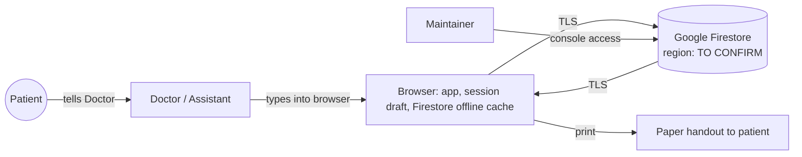

# Hope Clinic - Data Protection and Security Assessment

| | |
| --- | --- |
| Version | 1.0 (retrospective baseline) |
| Date | 4 October 2026 |
| Controller | The Doctor (the clinic) |
| Processor / maintainer | Munsif Musthafa (technical operator); Google (Firebase) as cloud processor |
| Related | [BRD](BRD.md), [SRS](SRS.md), [TDD](TDD.md) |

> This is a practical privacy impact assessment for a small practice, not legal advice. Sri Lanka's Personal Data Protection Act No. 9 of 2022 (PDPA) treats health data as a special category of personal data. Check current obligations and their effective dates with the Data Protection Authority's guidance or a qualified advisor before relying on the conclusions here.

## 1. Summary

Hope Clinic stores identifiable health records for real patients in Google Cloud Firestore. Access control is solid for a single clinic: database rules enforce sign-in and an approved role, and the release process never touches real data. The main gaps are operational rather than code:

1. **No tested backup or restore.** Losing the Firebase project or a bad write would lose records with no recovery.
2. **Offline data stays on devices after sign-out.** On a shared or lost device, previously viewed records may be readable.
3. **No written patient notice or retention policy.**
4. **Data location not confirmed.** The Firestore region has not been recorded, which matters for cross-border transfer rules.
5. **One person with production access and no second admin.** Lockout or unavailability blocks recovery.

Section 9 lists the actions in priority order.

## 2. Data inventory

| Category | Examples | Where stored | Sensitivity |
| --- | --- | --- | --- |
| Patient identity | Name, age, gender, contact number, address | `patients` | Personal |
| Health background | Medical and family history, ongoing medicines, allergies | `patients` | Special category (health) |
| Clinical encounters | Complaint, diagnosis, private notes, instructions, prescriptions, investigations | `visits` | Special category (health) |
| Financial | Consultation and medicine fees | `visits` | Personal |
| Scheduling | Appointment date/time, status (no names or clinical text) | `appointments`, `appointmentSlots`, `followups` | Personal (linked by ID) |
| Staff accounts | Email, name, role | Firebase Auth, `users` | Personal |
| Stock | Medicines, prices, suppliers | `inventory` | Business |
| Printed handouts | Name, age/sex, diagnosis, prescriptions, instructions | Paper given to patient | Special category |

Not collected: national ID numbers, photos, documents, payment card data, location, analytics or tracking data.

## 3. Purpose and lawful basis

- **Purpose:** providing and documenting medical care, continuity of care, and arranging return visits. Fee and stock data support running the practice.
- **Basis:** processing health data by a health professional for medical care is the expected basis under PDPA-style laws; patient consent is a fallback. Confirm the exact basis and whether a written patient notice is required.
- **Purpose limitation:** data must not be used for marketing, research, or AI training. No reminders or messages are sent.
- **Minimisation:** registration currently requires name, age and contact. The Doctor should confirm each is needed (BRD open decision 1).

## 4. Data flows

- **Processor:** Google Cloud / Firebase. Google's data processing terms apply to the Firebase project. Record which terms were accepted in the console.
- **Location:** Firestore location is fixed at project creation. Record it here: `________`. If it is outside Sri Lanka (most likely), note that this is a cross-border transfer and confirm what the PDPA requires for it.
- **Sub-processors:** none added by the app. No analytics, no error reporting service, no third-party scripts at runtime. Fonts and icons are bundled.
- **Dictation:** browser speech recognition may send audio to the browser vendor's servers. Treat dictation as off unless the Doctor consents after understanding this.

## 5. Access control

| Who | Access | Control |
| --- | --- | --- |
| Doctor | Everything in the app | Email/password; role `doctor` |
| Assistant (if any) | All records including private notes; cannot change prices or sessions | Role `assistant`. Note: Firestore cannot hide fields, so notes are readable |
| Maintainer | Full production data via Firebase console | Google account. Must not browse patient records without a reason |
| Unapproved accounts | Nothing | Rules deny |
| Public | Login page only | Hosting + rules |

Recommendations:

- Turn on 2-step verification for the Google account that owns the Firebase project and for anyone with console access.
- Add a second project owner (the Doctor or a trusted person) so recovery does not depend on one account.
- Use strong, unique passwords for clinic logins. Consider enabling Firebase Auth multi-factor for the Doctor.
- Review the `users` collection whenever staff change.

## 6. Device and on-device data

| Data on device | Persists | Risk |
| --- | --- | --- |
| Firestore offline cache (IndexedDB) | Until browser data is cleared, **including after sign-out** | Someone using the same browser profile could read cached records with developer tools |
| Consultation draft (`sessionStorage`) | Tab only, 24 hours max, cleared on sign-out | Low |
| Signed-in session | Until sign-out | Anyone with the unlocked device can use the app |
| Printed handouts | Physical | Normal paper confidentiality |

Device policy for the clinic (to agree with the Doctor):

1. Use the app only on the Doctor's own laptop and phone, each with a screen lock.
2. Use a separate browser profile for the clinic if the laptop is shared with family.
3. Sign out on any device that is not hers.
4. If a device is lost: change the account password, revoke sessions in Firebase Auth, and record the incident.

Code change recommended: clear the Firestore persistent cache on sign-out (TDD TD-04).

## 7. Retention, deletion and patient rights

- **Retention:** no policy exists. Medical records are usually kept for many years. Agree a period with the Doctor, guided by her professional council's expectations, and write it here: `________`.
- **Deletion:** a doctor can delete patients and visits through the database rules, but the app has no deletion UI and deleting a patient does not delete their visits. Deletion requests should go through the maintainer, be logged, and consider the retention period first.
- **Access requests:** a patient asking for their record can be given the printed handouts or a manual export. Note the request and date.
- **Correction:** the Doctor can edit records. There is no change history beyond `updatedBy` on visits (TDD TD-10).

## 8. Backup and recovery

Target: lose at most one day of records (RPO 24 hours), be back within one clinic day (RTO).

| Option | Needs | Notes |
| --- | --- | --- |
| Scheduled managed export to Cloud Storage | Blaze (pay-as-you-go) plan, a bucket, a schedule | Most reliable. Cost for this data size should be very small; set a budget alert |
| Manual `gcloud firestore export` | Blaze plan, maintainer discipline | Weekly at minimum |
| Point-in-time recovery | Blaze plan, enable on the database | Helps with bad writes within the PITR window; not a substitute for exports |
| Client-side JSON export | Code change | Works on the free plan; must be stored encrypted and offline |

Whichever is chosen, a backup only counts after a **restore rehearsal** into a separate Firebase project, with record counts compared. Store exports with access limited to the Doctor and maintainer.

## 9. Risk register and actions

| # | Risk | Likelihood | Impact | Action | Owner | Priority |
| --- | --- | --- | --- | --- | --- | --- |
| DP-1 | Records lost with no backup | Medium | Severe | Set up exports and rehearse restore (section 8) | Maintainer | 1 |
| DP-2 | Account takeover of Firebase owner | Low | Severe | 2-step verification; second owner | Maintainer | 1 |
| DP-3 | Cached records readable on shared device | Medium | High | Device policy; clear cache on sign-out | Maintainer + Doctor | 2 |
| DP-4 | Unclear legal basis, notice, cross-border transfer | Medium | Medium | Confirm Firestore region; check PDPA requirements; short patient notice if needed | Sponsor | 2 |
| DP-5 | No retention or deletion policy | Medium | Medium | Agree and record (section 7) | Doctor | 3 |
| DP-6 | Assistant sees private notes | Low (no assistant yet) | Medium | Split notes before adding an assistant | Maintainer | 3 |
| DP-7 | Patient data leaks into logs or test data | Low | High | Keep the "no patient data in logs" rule in code review; synthetic-only tests | Maintainer | Ongoing |
| DP-8 | Maintainer browses records unnecessarily | Low | Medium | Access only to fix a reported issue; note when it happens | Maintainer | Ongoing |

## 10. Incident response (one page)

1. **Contain:** change passwords, revoke sessions (Firebase Auth), remove `role` from affected accounts, or temporarily tighten rules to deny all reads.
2. **Assess:** what data, how many patients, how it happened. Do not copy patient data into chat tools or tickets while investigating.
3. **Recover:** restore from backup if data was lost or altered.
4. **Notify:** decide with the Doctor whether patients or the Data Protection Authority must be told, and within what time, according to current PDPA guidance.
5. **Record:** date, what happened, what was done, what changes.

## 11. Review

Review this assessment when any of these happen: an assistant is added, a second clinic is considered, messaging or any new third party is introduced, the hosting plan changes, or at least once a year.
