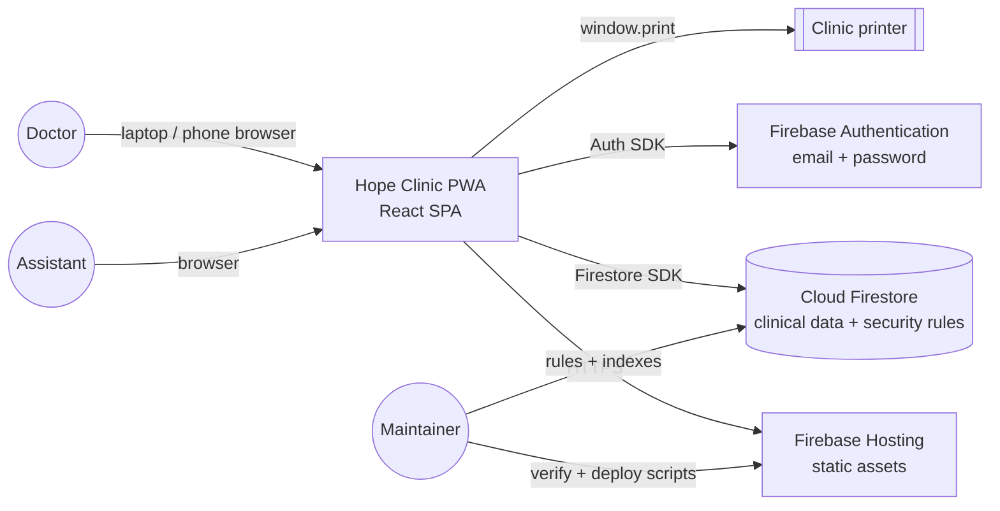
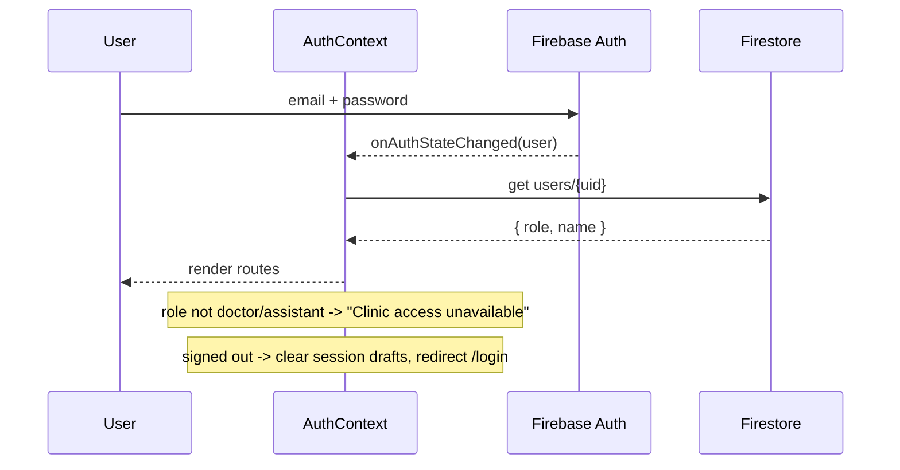
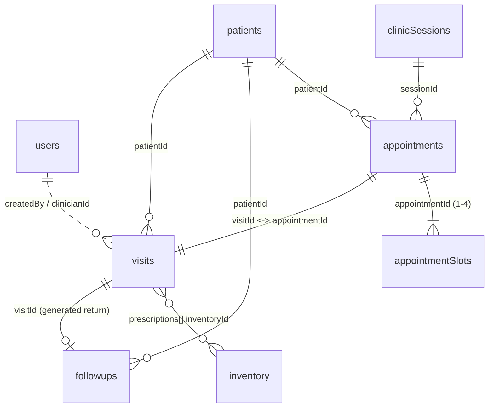
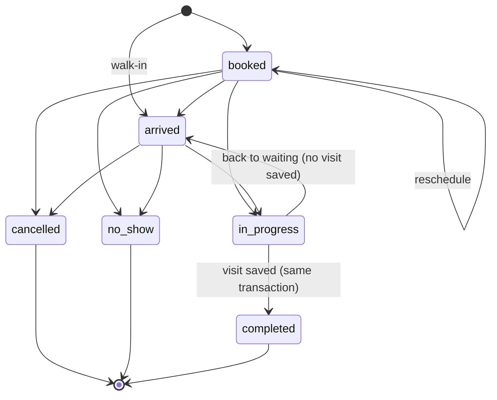
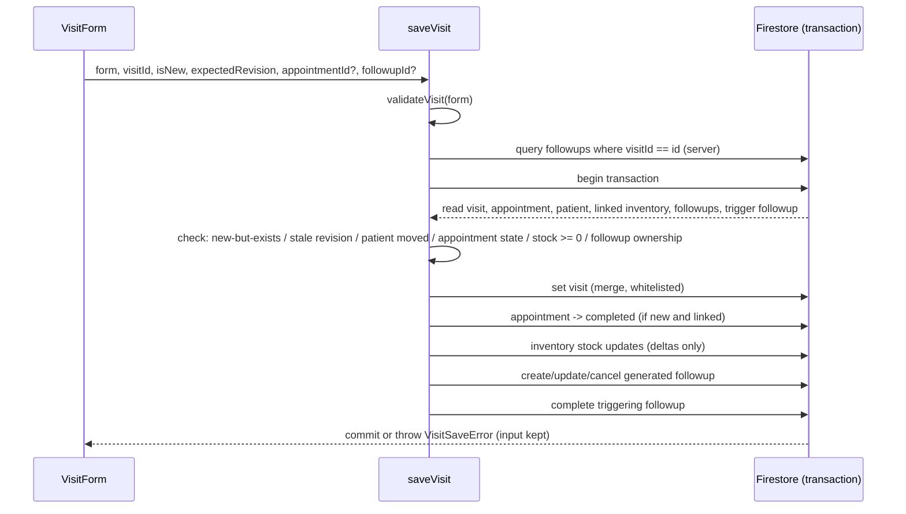
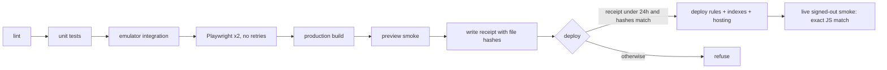

# Hope Clinic - Technical Design Document (TDD)

| | |
| --- | --- |
| Version | 1.0 (retrospective baseline) |
| Date | 4 October 2026 |
| Requirements | [BRD](BRD.md), [SRS](SRS.md) |
| Related | [Data Protection Assessment](DATA_PROTECTION.md), [Scheduling model](../SCHEDULING_MODEL.md), [Release process](../RELEASE.md) |
| Baseline | Commit `a8bb6c7`, deployed 16 September 2026 |

This document describes the system as built, the reasoning behind the main choices, and the known limits. Sections marked **Gap** describe design that is still needed. Line-level detail lives in the code; this document is the map.

## 1. Goals and non-goals

**Goals**

- A private, browser-based clinical record and day planner for one solo practice.
- Zero servers to operate and near-zero running cost.
- Strong data integrity for clinical writes: atomic, retry-safe, conflict-aware.
- Authorisation enforced in the database, not just the UI.
- Usable on a laptop during consultation and on a phone for lookup, including with patchy connectivity for reading.

**Non-goals (this phase)**

- Multi-clinic tenancy, public-facing features, messaging, billing, integrations.
- Offline writes for anything that must be authoritative (bookings, stock, completed visits).
- Server-side business logic (Cloud Functions).

## 2. System context



There is no backend code owned by the project. All business logic runs in the client, and all authorisation and cross-document invariants are enforced by Firestore security rules.

## 3. Architecture

### 3.1 Technology stack

| Layer | Choice | Version (package.json) |
| --- | --- | --- |
| UI | React | 19.2 |
| Routing | React Router | 7.10 |
| Build | Vite | 7.2 |
| Styling | Tailwind CSS via PostCSS, plus `src/index.css` | 4.1 |
| Icons / charts | lucide-react, Recharts | 0.555 / 3.5 |
| Auth | Firebase Authentication (email/password) | firebase 12.6 |
| Database | Cloud Firestore with persistent local cache | firebase 12.6 |
| Hosting | Firebase Hosting, SPA rewrite to `index.html` | - |
| PWA | vite-plugin-pwa (Workbox), prompt-to-update | 1.2 |
| Tests | node:test, Firebase emulators, Playwright | Node 22+, Playwright 1.63 |
| Language | JavaScript (no TypeScript) | - |

### 3.2 Architecture decisions

| ID | Decision | Why | Trade-off accepted |
| --- | --- | --- | --- |
| ADR-01 | Serverless: client SPA + Firebase, no custom backend | No servers to run, free tier, one maintainer | Business invariants must be expressible in security rules; complex workflows are harder |
| ADR-02 | Firestore security rules are the authorisation boundary | Client code can be bypassed; rules cannot | Rules become complex (scheduling rules in particular) and need emulator tests |
| ADR-03 | Multi-document writes go through `runTransaction` in service modules | Atomic, retried on contention, read-your-writes checks | Transactions fail offline - saving needs a connection |
| ADR-04 | Client-generated stable document IDs for new patients, visits, appointments | Makes retries idempotent; lets an appointment own its visit ID before the visit exists | IDs are random, not human-friendly |
| ADR-05 | Optimistic concurrency by comparing a canonical serialisation of the whole document (`visitRevision`) for patients and visits; integer `revision` for appointments | Works for legacy records with no revision field | Whole-document compare is strict; any field change by anyone is a conflict |
| ADR-06 | Capacity locking with one `appointmentSlots` document per 15-minute unit | Firestore has no unique constraints across ranges; per-slot docs make overlap a document collision | Up to 4 slot docs per appointment; rules use `getAfter` for each |
| ADR-07 | Additive schema evolution, no bulk migrations | Live clinical data, no migration tooling, small team | Readers must handle several historical shapes |
| ADR-08 | Drafts in `sessionStorage`, not Firestore | Simple, private to the tab, no cross-device sync questions | Drafts are lost when the tab closes; no cross-device resume |
| ADR-09 | Service worker caches the app shell only | Avoid storing clinical responses in a second cache | Offline reading relies only on Firestore SDK cache |
| ADR-10 | Clinic timezone fixed as `Asia/Colombo` for scheduling | Bookings must mean the same wall time on every device | Visit dates still use device local time (see section 11) |
| ADR-11 | Release gated by a local verification receipt bound to file hashes | One maintainer, no CI; prevents deploying untested code | Verification depends on the maintainer's machine (Java, Chrome) |

### 3.3 Code structure

```
src/
  main.jsx                 entry; local-demo banner when using emulators
  App.jsx                  providers + route tree
  config/firebase.js       Firebase init; emulator switch (dev only)
  contexts/                AuthContext (user, role, name), ToastContext
  components/              shell (Layout, ProtectedRoute), clinical UI pieces
  pages/                   one component per route
  services/                transactional writes: savePatient, saveVisit, scheduling
  hooks/                   live/read data hooks: useClinicSchedule, usePatientVisits
  utils/                   pure logic: validation, stock deltas, drafts, scheduling math, formatters
tests/                     unit, emulator integration, Playwright, demo seed
scripts/                   verify, deploy guard, production smoke
prototypes/clinic/         standalone UX prototype, no Firebase, not in prod build
firestore.rules            authorisation and invariants
firestore.indexes.json     composite indexes
```

Layering rule: pages call `services/` for writes and `hooks/` or direct reads for queries. `utils/` is pure and is where unit tests concentrate. Some pages (Dashboard, Inventory, FollowUps, Visits) still query Firestore directly; consolidating these is listed debt.

### 3.4 Routes

| Path | Component | Notes |
| --- | --- | --- |
| `/login` | `Login` | Public. Redirects to `/today` on success |
| `/` | `Dashboard` | Reports and overview |
| `/today` | `Today` | Sessions, agenda, waiting list, review-due list |
| `/patients`, `/patients/new`, `/patients/:id`, `/patients/:id/edit` | `Patients`, `PatientForm`, `PatientDetails` | |
| `/visits`, `/visits/new`, `/visits/:id/edit` | `Visits`, `VisitForm` | `new` accepts patient, appointment and follow-up context via query/state |
| `/visits/:id/print` | `PrintVisit` | Inside shell; print CSS hides navigation |
| `/inventory`, `/inventory/new`, `/inventory/:id/edit` | `Inventory`, `InventoryForm` | |
| `/followups` | `FollowUps` | |
| `*` | redirect to `/` | |

All routes except `/login` are children of `ProtectedRoute` + `Layout`. Route paths are a compatibility contract (see `AGENTS.md`).

## 4. Authentication and authorisation

### 4.1 Sign-in and role resolution



### 4.2 Rule model

- `hasClinicAccess()` = signed in and `users/{uid}.role` is `doctor` or `assistant`. Every clinical read requires it.
- Each rule evaluation reads the caller's `users` doc (one extra document read per request, Spark-plan compatible; no custom claims).
- Final `match /{document=**}` denies everything not listed.

| Collection | Read | Create | Update | Delete |
| --- | --- | --- | --- | --- |
| `users` | own doc, or clinic staff | doctor | doctor | doctor |
| `patients` | staff | staff | staff | doctor |
| `visits` | staff | staff, with valid appointment link | staff; `appointmentId` immutable | doctor, only if not appointment-linked |
| `inventory` | staff | doctor; stock >= 0 | doctor any field; assistant only `stock`, `notes`, `updatedAt`; stock >= 0 | doctor |
| `followups` | staff | staff | staff | doctor |
| `clinicSessions` | staff | doctor, valid shape | doctor, only `enabled`/`updatedAt` | never |
| `appointments` | staff | staff, valid shape, revision 0, patient exists, inside open session, owns all slots | staff, revision + 1, allowed status transition, slot ownership and release verified | never |
| `appointmentSlots` | staff | staff, must be covered by its appointment after the write | same appointment only | only if the appointment no longer covers it |

### 4.3 Known authorisation limits

- **Single tenant.** Any approved account sees all clinic data. Safe only while there is one clinic. A second clinic needs a `clinicId` scope in every document and rule (section 16).
- **No field-level read control.** Firestore reads whole documents. An assistant can read private clinical notes. If that matters, notes must move to a separate document or collection.
- **Account provisioning is manual.** The first doctor's `users` doc must be created in the Firebase console. There is no UI for managing staff.
- **No MFA, no session timeout.** Firebase Auth default persistence keeps users signed in on the device.

## 5. Data model

All collections are top-level. Timestamps are Firestore server timestamps unless stated. Dates and times stored as strings are clinic wall time.



### 5.1 `users/{uid}`

| Field | Type | Notes |
| --- | --- | --- |
| `role` | `'doctor' \| 'assistant'` | Anything else = no access |
| `name` or `displayName` | string | Printed as clinician for doctors |

### 5.2 `patients/{id}`

ID: client-generated Firestore auto-ID, fixed when the form opens.

| Field | Type | Notes |
| --- | --- | --- |
| `name` | string, required | Trimmed |
| `age` | number/string, required 0-130 | No reference date (gap) |
| `gender` | string | Empty = not recorded |
| `contact` | string, required | Free format; search normalises digits |
| `address` | string | |
| `medicalHistory`, `familyHistory`, `ongoingMedications`, `allergies` | array of `{ name, notes, ... }` | Legacy: plain string, single object, or array of strings. Read via `historyEntries()` |
| `createdAt`, `updatedAt` | timestamp | |

### 5.3 `visits/{id}`

ID: client-generated; for appointments, pre-allocated at booking.

| Field | Type | Notes |
| --- | --- | --- |
| `patientId` | string, required | Immutable after creation |
| `date` | `YYYY-MM-DD`, required | Device local date (see section 11) |
| `time` | `HH:mm`, required | |
| `complaint` | string | |
| `diagnosis` | string, required | |
| `notes` | string | Private. Never printed |
| `patientInstructions` | string | Printed |
| `prescriptions` | array of `{ name, quantity, dosage, frequency, duration, notes, inventoryId? }` | |
| `prescription` | string | Legacy free text, read only |
| `investigations` | array of string | |
| `consultationFee`, `medicineFee`, `cost` | number | `cost` = sum |
| `nextVisitDate`, `nextVisitTime` | string | Review due, not a booking |
| `appointmentId` | string, optional | Immutable once set |
| `clinicianId`, `clinicianName` | string, optional | Only when a doctor created the visit |
| `createdBy`, `updatedBy` | uid | |
| `createdAt`, `updatedAt` | timestamp | |

Writes use `set(..., { merge: true })` with a whitelist of known fields, so unknown legacy fields survive edits.

### 5.4 `inventory/{id}`

| Field | Type | Notes |
| --- | --- | --- |
| `name` | string | |
| `stock` | number >= 0 | Enforced by rules |
| `unit` | string | default `pcs` |
| `cost`, `sellingPrice` | number | Doctor-only changes |
| `supplier`, `expiryDate` | string | |
| `lowStockThreshold` | number | default 5 |
| `notes`, `updatedAt` | | |

### 5.5 `followups/{id}`

ID: `visit-{visitId}` for new records; legacy records have random IDs and are found by `visitId` query.

| Field | Type | Notes |
| --- | --- | --- |
| `patientId`, `visitId` | string | |
| `date`, `time` | string | Time optional |
| `status` | `pending \| completed \| cancelled` | |
| `updatedAt` | timestamp | |

Index: `status ASC, date ASC`.

### 5.6 Scheduling collections

Summarised here; the full contract is in [SCHEDULING_MODEL.md](../SCHEDULING_MODEL.md).

| Collection | Key fields | Invariants |
| --- | --- | --- |
| `clinicSessions/{id}` | `date`, `startMinute`, `endMinute`, `enabled` | 15-minute aligned; start < end; only `enabled` can change |
| `appointments/{id}` | `patientId`, `sessionId`, `date`, `startMinute`, `duration` (30/45/60), `kind` (`booked`/`walk_in`), `status`, `visitId`, `revision` | No clinical text or names. `patientId`, `visitId`, `kind`, `createdAt` immutable |
| `appointmentSlots/{date}_{minute}` | `appointmentId`, `date`, `minute` | Exists only while covered by an occupying appointment |

Appointment states:



`cancelled` and `no_show` release slots. `completed` keeps them as history.

## 6. Key write flows

### 6.1 Save visit (`services/saveVisit.js`)



Stock deltas: `stockChanges(previous.prescriptions, next.prescriptions)` adds back old linked quantities and subtracts new ones, aggregated per `inventoryId`, so edits apply only the difference.

### 6.2 Book or reschedule (`services/scheduling.js`)

1. Read the appointment (if rescheduling, require matching `revision` and status `booked`).
2. Read the session; validate duration, alignment, fit, not in the past (clinic timezone).
3. Confirm the patient exists.
4. Read each target slot; fail if held by another appointment.
5. Write the appointment with `revision + 1`, delete released old slots, write new slots.
6. Rules re-check all of the above with `getAfter`, so a modified client cannot bypass it.

Two staff booking the same time: both transactions read the free slot; the first commit wins, the second is retried by the SDK, sees the slot taken and fails with "That time was just taken". Covered by integration test.

### 6.3 Save patient (`services/savePatient.js`)

Validate, then transaction: reject if new-but-exists or stale revision; merge-write whitelisted fields.

## 7. Client state, drafts and caching

| Store | What | Lifetime | Cleared by |
| --- | --- | --- | --- |
| React state | Form in progress | Page | Navigation |
| `sessionStorage` key `hope-clinic:visit-draft:{uid}:{scope}` | Consultation draft (v1 envelope with `savedAt`) | Tab, max 24 hours | Successful save, discard, sign-out, expiry |
| Firestore persistent cache (IndexedDB) | Documents previously read | Until browser data is cleared | **Not** cleared on sign-out (gap) |
| Service worker precache | App shell (JS, CSS, HTML, icons) | Until next version activates | Update prompt |
| Emulator mode | Memory cache only | Page | - |

Invalid, corrupt or future-dated drafts are discarded rather than loaded into a clinical form.

## 8. Offline and PWA behaviour

- `registerType: 'prompt'`: a new version waits until the user accepts the update prompt. Users are told to save work first.
- `runtimeCaching: []`: Firestore responses are not cached by the service worker. `public/sw-cleanup.js` removes the old `firestore-cache` from earlier versions.
- Hosting headers: hashed JS/CSS/images cached for a year; `index.html`, `sw.js`, `registerSW.js` and the manifest are `no-cache`.
- Reads work offline from the Firestore cache. Transactions do not run offline, so saving visits, bookings and stock changes need a connection. The UI says so instead of queuing silently.

## 9. Printing

`PrintVisit` loads the visit and patient and renders `VisitPrintout`. The user previews, then presses Print (`window.print()`). Print CSS in `src/index.css` hides the app shell. Content rules: stored clinician only, private notes excluded, legacy combined notes only after explicit opt-in, review-due wording that does not promise a slot. Clinic address and phone come from `VITE_CLINIC_ADDRESS` / `VITE_CLINIC_PHONE` with fallbacks; the clinic name is hard-coded.

## 10. Error handling and user feedback

- Service errors are typed (`VisitSaveError`, `PatientSaveError`, `ScheduleError`) and carry user-facing text. Unknown errors map to a safe generic message.
- Failed saves never clear the form.
- Data hooks return `loading`, `error`, `cached` and `retry`, so screens can tell "could not load" apart from "no records". Older pages (Dashboard, Inventory, Visits) are not yet consistent.
- Toasts for outcomes; inline messages for validation.
- No `console` logging of patient data. `AuthContext` logs a generic role-fetch error only.

## 11. Dates, times and localisation

- Scheduling uses `CLINIC_TIME_ZONE = 'Asia/Colombo'` via `Intl.DateTimeFormat`, and minutes-since-midnight integers.
- Visits and follow-up overdue logic use the **device's** local date and time (`localDate()`). This matches clinic time only while devices are set to Sri Lanka time. Aligning visits with the clinic timezone is listed debt.
- Display formatting: `en-LK` locale, currency `Rs.` (`utils/formatters.js`).
- Strings are English only. No i18n framework.

## 12. Environments, build and release

| Environment | Firebase project | Data | How |
| --- | --- | --- | --- |
| Local demo | `demo-hope-clinic` (emulators: Auth 9099, Firestore 8080) | Synthetic, `tests/seed-demo.mjs` | `VITE_USE_EMULATORS=true npm run dev` - only honoured in dev builds |
| Verification | Emulators + local production preview (port 15180) | Synthetic | `npm run verify` |
| Production | `.firebaserc` default | Real patient data | `npm run deploy` |

Config: Firebase web config in `.env.local` (git-ignored; see `.env.example`). `verify` asserts the client project ID matches the deploy target without printing values.

Release pipeline (detail in [RELEASE.md](../RELEASE.md)):



Rollback: Firebase Hosting release history for the site, plus restoring the previous rules version separately. Never delete data to roll back.

**Provisioning a new staff account (manual):** create the user in Firebase Authentication, then create `users/{uid}` with `role` and `name` in the console. Disable access by changing or removing `role`.

## 13. Testing strategy

| Level | Tooling | Scope | Count (Sep 2026) |
| --- | --- | --- | --- |
| Unit / render | `node --test tests/*.test.mjs` | Pure utils: validation, stock deltas, revisions, drafts, scheduling math, timezone rollover, history and print rendering | 19 |
| Integration | Firebase emulators + real `firestore.rules` | Services and rules together: denial of unknown accounts, assistant limits, atomic rollback, idempotent retries, concurrent edits, booking races, slot tampering, state transitions | 19 |
| End-to-end | Playwright, Chrome, run twice, no retries, external network blocked | Register, book, reschedule, arrive, draft recovery, reviewed save, print privacy, phone lookup, sign-out protection | 1 journey |
| Production smoke | Playwright, signed out, GET-only | Protected redirect, login, service worker, cache headers, live JS equals verified build, phone width | 1 |
| Manual | Doctor walkthrough | Real devices, real printer, comprehension | Outstanding |

Principles: synthetic data only; tests never touch production records; every security rule change ships with an emulator test; a flaky test is a defect, not a retry.

Not covered: accessibility audit, physical printer, real phone hardware, performance budgets, browsers other than Chrome.

## 14. Performance and scaling

Current access patterns that will not scale indefinitely:

| Where | Pattern | Effect at scale |
| --- | --- | --- |
| `Patients`, `PatientForm`, `VisitForm`, `useClinicSchedule` | Load the entire `patients` collection | Reads and memory grow with every patient; Today subscribes live to all patients |
| `VisitForm` | Load entire `inventory` | Fine for hundreds of items |
| `Dashboard` | Whole `patients` and `inventory`; 7 daily visit queries | Cost on every dashboard open |
| `Visits` | Latest 50 only | Older visits not searchable there |
| `PatientDetails`, `usePatientVisits` | All visits for one patient | Fine |

For one practice (low thousands of patients) this is acceptable on the free tier. Before growth: paginate patient search or keep a lightweight search index document, replace full-collection subscriptions on Today with appointment-driven patient fetches, and add date-bounded dashboard queries. The main JS bundle is about 1 MB minified; route-level code splitting is the first step if cold start is slow on the Doctor's laptop.

## 15. Operations

| Area | Current state | Needed |
| --- | --- | --- |
| Backups | **None verified** | Scheduled Firestore export to Cloud Storage (requires the Blaze plan) or a manual `gcloud firestore export` routine, plus a rehearsed restore into a separate project. See [DATA_PROTECTION.md](DATA_PROTECTION.md) |
| Monitoring | None | Budget alert on the Firebase project; optional client error reporting with patient data scrubbed |
| Support | Maintainer by phone | Short user guide; known-issues list |
| Access reviews | Manual | Review `users` roles when staff change |
| Dependency updates | Ad hoc | Quarterly `npm outdated` and `npm audit`, then `verify` |

## 16. Technical debt and risk register

| ID | Item | Impact | Proposed fix |
| --- | --- | --- | --- |
| TD-01 | No tested backup/restore | Permanent data loss | Section 15 |
| TD-02 | Clinical save coupled to stock | Inaccurate stock blocks recording care | Separate dispensing record with idempotent stock movements |
| TD-03 | Drafts are tab-only | Interrupted work lost on tab close or device switch | Firestore `visitDrafts` scoped by user, separate from visits |
| TD-04 | Firestore cache persists after sign-out | Data readable on a shared device | `clearIndexedDbPersistence` on sign-out, or memory cache on untrusted devices |
| TD-05 | Single tenant rules | Cannot onboard a second clinic safely | `clinicId` on every document, membership collection, rules scoped by membership, migration with backup |
| TD-06 | Private notes readable by assistants | Least-privilege gap | Split notes into a doctor-only subdocument if an assistant is added |
| TD-07 | Visit dates use device timezone | Wrong date if a device clock/zone is off | Use `clinicDate()` for visits too |
| TD-08 | Full-collection loads | Cost and latency with growth | Section 14 |
| TD-09 | Some pages query Firestore directly and handle errors inconsistently | Errors can look like empty lists | Move reads into hooks returning `loading/error/retry` |
| TD-10 | No edit history for visits | Corrections are not attributable beyond `updatedBy` | Append-only revisions subcollection |
| TD-11 | Hard delete of inventory and patients | Broken references in history | Archive flag; restrict delete |
| TD-12 | Clinic identity hard-coded (name, fallback address/phone) | Blocks reuse by other clinics | Clinic settings document |
| TD-13 | Age without reference date | Age becomes wrong over time | Store `ageRecordedAt` or DOB, never infer |
| TD-14 | README is the Vite template | Onboarding friction | Replaced alongside this documentation set |
| TD-15 | Release depends on maintainer's machine | Bus factor | GitHub Actions running `verify` on pull requests |

## 17. Future: multi-clinic design outline

Not to be built until the single-clinic pilot succeeds. Outline only:

- `clinics/{clinicId}` with settings (name, address, timezone, currency, sessions defaults).
- `memberships/{clinicId}_{uid}` with role and active flag; rules default deny.
- Every clinical document gains an immutable `clinicId`, or moves under `clinics/{clinicId}/...`. Choose via an ADR before migrating.
- Slot IDs become `{clinicId}_{date}_{minute}`.
- One-time migration of existing data into the first clinic, with backup, dry run on a copy, counts and reference checks, and a write freeze during cutover.
